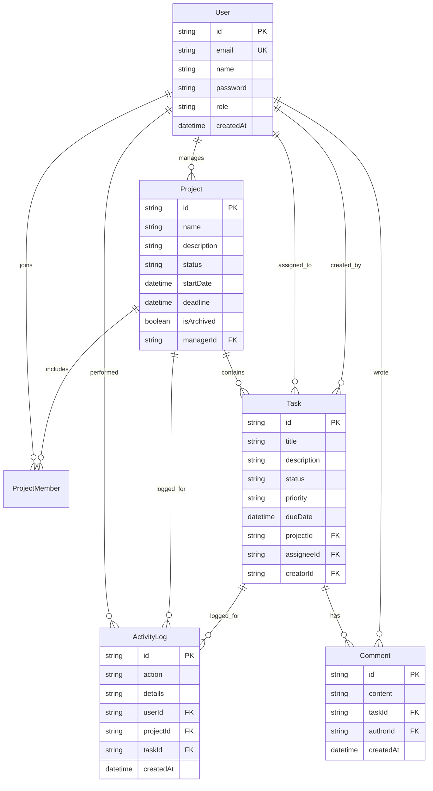

# Project & Team Management System

A robust, full-stack, enterprise-grade Project and Team Management System built with **React 19, TypeScript, Tailwind CSS, Vite, Express, Prisma ORM, and SQLite / PostgreSQL**.

Designed for organizations to manage projects, assign tasks to team members, track deliverable progress, and monitor deadlines through real-time dashboards and interactive Kanban workflows.

---

## 🌟 Key Features

### 1. Role-Based Access Control (RBAC) & Authentication
- **User Roles**:
  - **Admin**: Full administrative control over users, role reassignment, projects, tasks, and deletion.
  - **Project Manager**: Project creation, editing, member assignments, and task management within authorized projects.
  - **Team Member**: View assigned projects, track tasks, update execution status, and collaborate via comments.
- **Security & Authorization**:
  - Passwords hashed with `bcryptjs`.
  - Stateless JSON Web Tokens (`JWT`) authentication with 7-day expiration.
  - Rate limiting on authentication routes against brute-force attacks via `express-rate-limit`.
  - HTTP header protection with `helmet` and secure CORS policy.
  - Server-side role enforcement on every protected endpoint.

### 2. Project Management
- Create, view, update, archive, and delete projects.
- Define start date, deadlines, project manager, and assign initial team members.
- Real-time progress calculation based on dynamic completion of project tasks (`0% - 100%`).
- Project statuses: `PLANNING`, `ACTIVE`, `ON_HOLD`, `COMPLETED`.

### 3. Task Management & Interactive Kanban Board
- Full CRUD operations on tasks.
- Kanban Board view (`To Do`, `In Progress`, `In Review`, `Done`) with instant status transitions.
- Table / list view with sortable columns and pagination.
- Task priorities: `LOW`, `MEDIUM`, `HIGH`, `CRITICAL`.
- Multi-dimensional filters: by project, assignee, priority, status, and text search.
- Overdue deadline alerts for tasks past due dates.

### 4. Executive Dashboard & Metrics
- Dynamic, real-time KPI metrics calculated directly from database records:
  - Total projects, active projects, completed projects, and projects in planning/on-hold.
  - Total task count and pipeline distribution (`TODO`, `IN_PROGRESS`, `IN_REVIEW`, `DONE`).
  - Overdue task count and tasks assigned to the logged-in user.
  - Organization-wide completion rate percentage.

### 5. Collaboration & Audit Logs
- Nested task comment threads with timestamping and author details.
- Comprehensive audit trail (`ActivityLog`) capturing user actions (project creation, updates, task assignments, and status shifts).

---

## 🛠️ Technology Stack

| Layer | Technology |
|---|---|
| **Frontend** | React 19, TypeScript, Vite, Tailwind CSS, Lucide Icons, React Router 6, Axios, date-fns |
| **Backend** | Node.js, Express, TypeScript, Zod, Helmet, Express Rate Limit, Morgan |
| **ORM & Database** | Prisma ORM, SQLite (local zero-config) / PostgreSQL ready |
| **Testing** | Jest, ts-jest, Supertest |

---

## 🚀 Quick Start Guide

### 1. Prerequisites
- **Node.js**: v18+ or v20+
- **npm**: v9+

### 2. Installation
Clone the repository and install dependencies in both folders:

```bash
# In the root repository directory
cd backend && npm install
cd ../frontend && npm install
cd ..
```

### 3. Database Migration & Seeding
Initialize the SQLite database schema and seed demo users, projects, tasks, and audit logs:

```bash
cd backend
npx prisma db push
npm run seed
```

### 4. Seed Credentials

The database comes pre-seeded with 3 roles ready for testing:

| Role | Email | Password |
|---|---|---|
| **Admin** | `admin@way2webs.com` | `Password123!` |
| **Project Manager** | `pm@way2webs.com` | `Password123!` |
| **Team Member** | `alice@way2webs.com` | `Password123!` |
| **Team Member** | `bob@way2webs.com` | `Password123!` |

*(The frontend login screen also includes one-click demo login buttons for each role).*

### 5. Running the Application

In terminal 1 (start backend API on port 5001):
```bash
cd backend
npm run dev
```

In terminal 2 (start frontend Vite dev server on port 5173):
```bash
cd frontend
npm run dev
```

Open your browser at `http://localhost:5173`.

---

## 🧪 Automated Testing

The backend includes a comprehensive integration test suite covering authentication, RBAC authorization barriers, validation errors, project lifecycle, and cascading task deletion:

```bash
cd backend
npm test
```

### Test Coverage Highlights:
- Rejection of invalid login credentials and malformed emails.
- User registration and token generation.
- Role-based barriers (e.g., verifying Team Members receive `403 Forbidden` when attempting to create projects or alter task metadata).
- Task status updates by assigned members.
- Real-time KPI calculations.
- Cascading delete verification on project deletion.

---

## 📊 Database Schema (Entity-Relationship)



---

## 🔌 API Reference

### Authentication
- `POST /api/auth/register` - Create a new user account with role.
- `POST /api/auth/login` - Authenticate with email/password and obtain JWT.
- `GET /api/auth/me` - Retrieve current authenticated profile.

### Projects
- `GET /api/projects` - List authorized projects (supports `?search=` and `?status=`).
- `POST /api/projects` - Create project (`ADMIN` & `PROJECT_MANAGER` only).
- `GET /api/projects/:id` - Fetch project details, members, tasks, and audit logs.
- `PATCH /api/projects/:id` - Update project details and status.
- `DELETE /api/projects/:id` - Delete project and cascade tasks (`ADMIN` or owner `PM`).
- `POST /api/projects/:id/members` - Assign team member to project.
- `DELETE /api/projects/:id/members/:userId` - Remove member from project.

### Tasks
- `GET /api/tasks` - List tasks with pagination, filtering (`projectId`, `assigneeId`, `priority`, `status`, `search`), and sorting.
- `POST /api/tasks` - Create task (`ADMIN` & `PROJECT_MANAGER` only).
- `GET /api/tasks/:id` - View task details, comments, and activity history.
- `PATCH /api/tasks/:id` - Update task (Team members restricted to updating status of assigned tasks).
- `DELETE /api/tasks/:id` - Delete task (`ADMIN` & `PROJECT_MANAGER` only).
- `POST /api/tasks/:id/comments` - Post comment on task.

### Dashboard & Users
- `GET /api/dashboard/summary` - Aggregate metrics (project/task status distribution, overdue count, completion percentage).
- `GET /api/users` - List users.
- `PATCH /api/users/:id/role` - Update user role (`ADMIN` only).
- `DELETE /api/users/:id` - Delete user account (`ADMIN` only).
